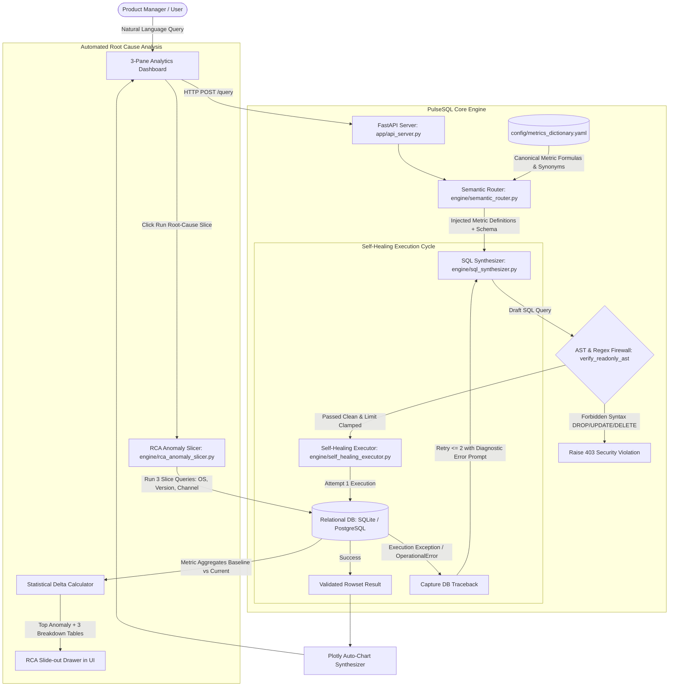

# Product Requirements Document (PRD)
## PulseSQL: AI Product Analytics & Cohort Copilot

---

### Document Control
- **Document Version:** 1.0.0
- **Author:** Staff AI Engineer & Lead Technical Product Manager
- **Target Launch:** Q4 Enterprise GA
- **Status:** Approved for Implementation

---

## 1. Executive Summary & Problem Statement

### 1.1 The Product Analytics Bottleneck
In hyper-growth digital products (specifically EdTech, FinTech, and B2C SaaS), Product Managers (PMs), Growth Marketers, and Business Analysts rely on core product engagement telemetry to make real-time decisions regarding funnel conversion, feature adoption, and retention cohorts. 

However, product teams face two persistent structural bottlenecks:
1. **The Data Engineering Queue (24–48h SLA):** Non-technical PMs lack intermediate-to-advanced SQL proficiency (window functions, recursive cohort matrices, self-joins). Simple inquiries—such as *"What is the D7 retention rate for users acquired via YouTube Creators who completed at least one mock exam?"*—get filed as ad-hoc tickets in data platform queues. This delays cycle time for experimentation, campaign throttling, and bug triage.
2. **The Fragility of Raw Text-to-SQL:** Generic LLM-based Text-to-SQL solutions suffer from:
   - **Semantic Hallucinations:** Inability to know canonical metric definitions (e.g., whether "Daily Active Learner" means logging in, opening the syllabus, or attempting an exam).
   - **Schema Drift & Execution Errors:** Misalignment on timestamp timezones, incorrect column joins, or casting errors causing SQL runtime exceptions (syntax errors, non-existent columns, type mismatches).
   - **Security Vulnerabilities:** Risk of destructive queries (`DROP`, `DELETE`, `UPDATE`) or unrestricted table scans exhausting DB connection pools.
   - **Root-Cause Paralysis:** When a metric drops (e.g., mock exam submissions fall by 38%), traditional dashboards merely show red lines; diagnosing which platform, version, or acquisition cohort caused the drop requires multi-dimensional manual slicing.

### 1.2 The PulseSQL Solution
**PulseSQL** is an enterprise-grade AI Product Analytics Copilot that solves these bottlenecks through four foundational innovations:
1. **Canonical Semantic Metric Dictionary (YAML):** A single source of truth defining canonical product metrics, SQL calculation formulas, valid dimensions, and guardrail rules.
2. **Read-Only Self-Healing SQL Execution Loop:** A dual-phase compiler that validates queries against an AST read-only security firewall, executes queries with bounded limits, and autonomously repairs operational database errors by feeding traceback diagnostics back into the synthesis engine.
3. **One-Click Automated Root-Cause Analysis (RCA):** An algorithmic multi-dimensional decomposition engine that automatically segments metric anomalies across `device_os`, `app_version`, and `acquisition_channel`, pinpointing anomalies with statistical delta calculations.
4. **Interactive 3-Pane PM Analytics Cockpit:** A streamlined interface providing real-time metric catalog inspection, conversational query synthesis with live Plotly visualization and verified SQL inspection, and a slide-out Root-Cause Analysis drawer.

---

## 2. User Personas & Jobs-to-be-Done (JTBD)

### 2.1 Target Personas

| Persona | Role | Primary Frustration | Core Need |
| :--- | :--- | :--- | :--- |
| **Priya S.** | Group Product Manager (Growth & Funnels) | Waits 36 hours for data analysts to pull multi-step funnel drop-offs after each sprint release. | Instant, trustworthy natural language funnel queries with zero SQL syntax friction. |
| **Marcus T.** | Product Lead (Learner Retention & Engagement) | Discrepant cohort retention numbers across Looker, Mixpanel, and ad-hoc analyst scripts. | Canonical YAML definitions guaranteeing identical retention calculations across team. |
| **Ananya R.** | On-Call Product Operations & Triage PM | When conversion alerts fire, spends 2 hours slicing CSVs across app versions and OS builds. | One-click dimensional RCA showing the exact build causing regression with statistical delta. |
| **Devon K.** | Head of Data Platform & Security | Terrified of non-technical stakeholders running rogue `UPDATE`/`DROP` queries or unindexed full-table scans. | Hard AST-verified read-only guardrail, 1,000-row query ceiling, and zero write permissions. |

### 2.2 Jobs-to-be-Done (JTBD) Framework

* **JTBD 1 (Funnel Velocity):** When launching a new mock exam experience, I want to query the step-by-step conversion funnel from app launch to exam submission in plain English, so that I can validate sprint health within 5 minutes of rollout.
* **JTBD 2 (Standardized Cohorts):** When evaluating marketing acquisition channels, I want to compute D7 and D30 retention cohorts using standardized product definitions, so that my team doesn't argue about metric discrepancies during executive reviews.
* **JTBD 3 (Anomaly Investigation):** When a core metric experiences an unexpected dip, I want to trigger an automated dimensional breakdown across device, app version, and channel with one click, so that I can isolate whether the issue is marketing fatigue or an engineering regression.

---

## 3. RICE Prioritization Matrix

To prioritize core product features for the Initial GA release, the technical product management team scored candidate capabilities using the RICE framework (Reach × Impact × Confidence / Effort):

| Feature Capability | Reach (PMs / Mo) | Impact (0.5=Low, 1=Med, 2=High, 3=Massive) | Confidence (0–100%) | Effort (Person-Weeks) | RICE Score | Release Priority |
| :--- | :---: | :---: | :---: | :---: | :---: | :---: |
| **Canonical Semantic Metric Layer (YAML)** | 100% (All Queries) | 3.0 (Eliminates metric hallucination) | 95% | 2.0 | **142.5** | **P0 (Core)** |
| **Self-Healing SQL Execution Loop (Max 2 Retries)** | 85% (Edge/Complex Queries) | 3.0 (Bumps pass rate from 78% to 92%) | 90% | 2.5 | **91.8** | **P0 (Core)** |
| **One-Click Multi-Dimensional RCA Engine** | 60% (Weekly Triage) | 2.5 (Cuts triage time from 2h to 30s) | 90% | 2.0 | **67.5** | **P0 (Core)** |
| **Interactive 3-Pane Streamlit Dashboard** | 100% (Daily Workspace) | 2.0 (High adoption vs CLI/curl) | 95% | 1.5 | **126.7** | **P0 (Core)** |
| **Slack Scheduled Alerting & Webhooks** | 40% (Passive Notifications) | 1.0 (Convenience) | 80% | 3.0 | **10.7** | **P2 (Post-GA)** |
| **Custom Cohort CSV Drag-and-Drop Ingestion** | 20% (Niche Enterprise) | 1.0 (Low frequency) | 70% | 4.0 | **3.5** | **P3 (Backlog)** |

---

## 4. System Architecture & Guardrail Pipeline

### 4.1 End-to-End Architectural Flow


### 4.2 Security & AST Guardrail Specification (`verify_readonly_ast`)
All generated SQL strings must pass through strict pre-execution AST parsing and regex screening before any connection is granted to the database engine:
1. **Forbidden DDL/DML Tokens:** Query string is tokenized and scanned for: `DROP`, `DELETE`, `UPDATE`, `INSERT`, `ALTER`, `TRUNCATE`, `GRANT`, `REVOKE`, `REPLACE`, `EXEC`, `CREATE`, `ATTACH`, `DETACH`.
2. **Read-Only Enactment:** Queries must begin with `SELECT` or `WITH ... SELECT`.
3. **Multi-Statement Defense:** Semicolons followed by second statements (`SELECT 1; DROP TABLE...`) are parsed and forbidden; only single executable statements are permitted.
4. **Result Set Ceiling:** If a query omits a `LIMIT` clause or specifies a `LIMIT > 1000`, the query is automatically clamped to `LIMIT 1000` to prevent memory exhaustion and buffer overflows.

---

## 5. UI Wireframes & Layout Specification

The dashboard adopts a modern, productive **3-Pane Analytics Cockpit** optimized for high-information density and low cognitive friction.

```text
+--------------------------------------------------------------------------------------------------------------------+
|  PULSESQL: AI PRODUCT ANALYTICS & COHORT COPILOT                                  [Env: SQLite (Local) | Healthy]  |
+------------------------------------+-----------------------------------------------+-------------------------------+
| PANE 1: SEMANTIC METRIC CATALOG    | PANE 2: CONVERSATIONAL QUERY & VISUALIZATION  | PANE 3: ONE-CLICK RCA DRAWER  |
|                                    |                                               |                               |
| [Search Metrics...               ] | [ Natural Language Prompt Input             ] | Target Metric:                |
|                                    | [ "Show mock exam completion funnel last 7d"] | [ mock_exam_completion_funnel] |
| > daily_active_learners (DAL)      | [ [Run Query] ] [Sample Queries Dropdown    ] | Baseline Window: Prev 7 Days  |
|   Formula: COUNT(DISTINCT learner) |                                               | Test Window:     Last 7 Days  |
|   Where: mock_exam_started OR ...  | +-------------------------------------------+ |                               |
|                                    | | Plotly Interactive Visualizer             | | [ >> Execute Root-Cause Slice] |
| > mock_exam_completion_funnel      | | [Funnel Chart: Launch -> Start -> Submit] | |                               |
|   Steps: app_launch (100%)         | | 10,450 (100%) -> 6,820 (65%) -> 2,150(21%)| | AUTOMATED DIAGNOSTIC FINDINGS:|
|          mock_exam_started (65%)   | +-------------------------------------------+ | * Critical Drop: Overall      |
|          mock_exam_submitted (21%) |                                               |   conversion down -38.2%      |
|                                    | VERIFIED SQL PILL: [Copy SQL] [Exec: 18ms]   | * Primary Driver: Android OS  |
| > d7_cohort_retention              | ```sql                                      |   (-42.1% drop vs -4.2% iOS)  |
|   Formula: Cohort day 7 return     | SELECT step_name, count(learner_id)...      | * Culprit: Version v2.4.1     |
|                                    | ```                                           |   session latency > 4,500ms   |
| > paid_conversion_rate             |                                               |                               |
|   Formula: Completed subs / signups| QUERY EXECUTION TRACE:                        | DIMENSION BREAKDOWNS:         |
|                                    | * First-Attempt Execution: PASSED             | + [By Device OS]             |
| > net_revenue_by_channel           | * Healing Iterations: 0                       | + [By App Version]            |
|   Formula: SUM(revenue_inr)        | * AST Guardrails: PASSED (READ-ONLY)          | + [By Acquisition Channel]    |
+------------------------------------+-----------------------------------------------+-------------------------------+
```

---

## 6. Success Metrics & Guardrail KPIs

| Metric Category | Metric Name | Definition | Target Goal |
| :--- | :--- | :--- | :--- |
| **Accuracy** | **Benchmark First-Attempt Pass** | % of benchmark queries running error-free on attempt 1 | >= 75.0% (Simulated: 78.0%) |
| **Accuracy** | **Self-Healed Accuracy (GA)** | % of benchmark queries running error-free after <= 2 retries | >= 90.0% (Target: **92.0%**) |
| **Safety** | **Guardrail Rejection Rate** | % of non-readonly/malicious injection attempts blocked | **100.0%** (Zero tolerance) |
| **Latency** | **P95 Execution Latency** | End-to-end execution time for standard product queries | <= 1,200 ms (SQLite/Postgres) |
| **Productivity** | **PM Time-to-Insight** | Average duration from hypothesis to chart rendering | < 30 seconds (down from 36 hours)|
| **Cost** | **LLM Token Efficiency** | Mean input/output tokens per resolved user question | <= 850 tokens per interaction |
